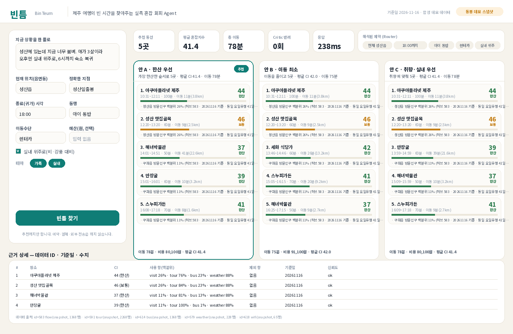
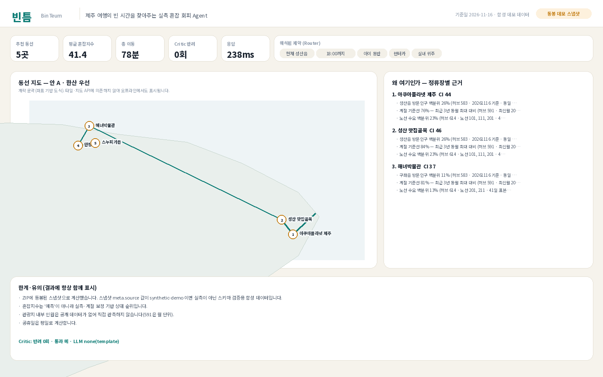

# 빈틈(BinTeum) — 제주 여행의 빈 시간을 찾아주는 실측 혼잡 회피 Agent

**제주 AI·빅데이터 활용 AI Agent 개발 챌린지 · 기획서(15p 이내)**

> 작성: 2026-11-16 · 개인 참가 `gigaminkyu` · 제출물: 실행 소스 코드 + 실행환경·매뉴얼 + 데이터 활용 명세 + 결과 설명자료

> **읽는 법** — 각 `pN` 제목이 한 페이지의 시작입니다. p1~p2는 요약, p3~p7은 서비스, p8~p11은 Agent 구조,
> p12~p13은 데이터, p14~p15는 개발·탑재·검증입니다. 회색 박스는 "심사 관점 메모"입니다.

---

## p1. 표지 + 한 장 요약

### 빈틈(BinTeum)
### 제주 여행의 빈 시간을 찾아주는 실측 혼잡 회피 Agent

> **"지금 이 시각, 어디가 한산한가"를 데이터로 답하고 남은 하루 동선을 다시 짭니다.**

| 1,386만 | 24개 읍면동 | 3안 |
|---|---|---|
| 2025년 제주 방문객(내국인 1,161만) | 실측 유동인구를 매일 받는 공간 단위 | 조건별 동선 대안 + 근거 데이터 ID |

**차별점 3줄**

1. 혼잡도를 **군중 신고·검색량이 아니라 읍면동 실측 유동인구**(제주데이터허브 id=583, 일 단위 자동 갱신)로 계산합니다.
2. 추천마다 **데이터 ID·기준일·백분위 수치**가 붙고, 근거가 없는 후보는 **Critic 에이전트가 스스로 반려**합니다.
3. 아이 동반·부모님 동반·실내 조건·귀가시간 같은 **제약을 동선 생성 조건**으로 씁니다.
   경로를 권하는 기존 서비스와 달리, 빈틈은 **남은 하루**를 다시 짭니다.



*그림 1은 실제 실행 결과(JSON)를 그대로 사용해 UI 레이아웃으로 그린 목업입니다. 실제 화면은 `out/reports/*.html`(서버 없이 열림)에서 확인할 수 있습니다.*

> **심사 관점** — 배점 50점(기술성 25 + 실용성 25)은 "돌아가는 화면"에서 나옵니다. 이 기획서의 모든 수치는
> ZIP에 들어 있는 코드로 재현됩니다(`./run.sh` 1분, `pytest` 95개 통과, 샘플 시나리오 3종 자동 실행).

**데이터 모드 고지(정직성)** — 제출 시점에 제주데이터허브 Open API로 **필수 데이터 583을 직접 수집**했습니다
(2026-06-24~08-19, 읍면동 43개, 원본 39,216행 → 읍면동·일별 **2,451셀**). 수집분은 ZIP의 `data/snapshot/live/flow.json`에
동봉되어 **유동인구 백분위는 실측값**입니다. 591·614·579·618은 프로젝트 미연결(403)로 **합성 스냅샷**이며,
화면 배지(`실측 + 일부 스냅샷`)·결과 JSON·리포트에 출처가 표시됩니다. 허브가 **2026-08-19 이후를 아직 적재하지 않아**
기준일은 2026-08-19입니다.

---

## p2. 목차 · 읽는 법 · 용어

| 절 | 페이지 | 내용 | 대응 평가 항목 |
|---|---|---|---|
| 1. 구현목표 | p3~p4 | 문제 정의, 분석 주제, KPI·비목표 | 타당성·창의성 15 |
| 2. 서비스 제안 | p5~p7 | 시나리오 3종, 기능 4개, 화면, CI 산식 | 실용성 25 + 신뢰성 |
| 3. Agent 개발 구성 | p8~p11 | 아키텍처, 역할·Tool, Workflow·자율범위, 모델·프롬프트 | 기술성·완성도 25 |
| 4. 데이터 활용 계획 | p12~p13 | 필수 데이터 표(id), 전처리·매핑, 센터 연계, 이용조건 | **데이터 활용 20** |
| 5. 개발·탑재 계획 | p14~p15 | 범위·환경·일정·매뉴얼, 외부 의존성·리스크·재현·한계 | 완성도 + 신뢰성 15 |

**용어 3개**

- **CI(혼잡지수, 0~100)** — "이 관광지가 지금 얼마나 붐비는가"의 **상대 순위**. 절대 인원이 아니라 백분위의 가중합입니다(p7).
- **읍면동 매핑** — 카탈로그의 관광지 63곳을 행정 읍면동(24개)에 연결해, 관광지 단위 실측이 없는 한계를 데이터로 메웁니다(p13).
- **스냅샷 폴백** — API가 죽거나 키가 없어도 ZIP 안의 데이터로 동작하는 이중 모드. 화면에 모드가 항상 표시됩니다(p15).

> **심사 관점** — 이 기획서는 "무엇을 만들었는가"보다 "**무엇이 검증되었는가**"를 먼저 씁니다.
> 검증되지 않은 수치는 쓰지 않고, 검증되지 않은 부분은 p15에 한계로 명시했습니다.

---

## p3. 1. 구현목표 — 1.1 문제 정의

### 제주는 여전히 붐비는데, "지금 어디가 한산한지"는 아무도 숫자로 말해주지 않는다

2025년 제주 방문객은 **1,386만 1,748명**, 그중 내국인 **1,161만 9,551명**(전년보다 2% 감소)입니다
(제주도관광협회 집계, 2026-01-31 보도 기준).
수요는 1,300만 명대인데 방문은 **소수 핫플에 집중**되고, 그 결과는 주차 대기·입장 대기·도로 정체로 나타납니다.
여행자는 그 자리에서 이렇게 묻습니다 — *"지금 여기 붐비는데, 애 데리고 어디 가지?"*

이 질문에 답하는 기존 수단은 셋인데, 셋 다 **"지금·이 사람"**을 다루지 못합니다.

| 기존 대안 | 작동 방식 | 한계 |
|---|---|---|
| 지도앱의 "붐빔" 표시 | 군중 신고·검색량·체류 추정 | **근거 수치가 없고** 제주 읍면동 단위 실측이 아님. 왜 붐비는지, 대안이 어디인지 알려주지 않음 |
| 제주도 분산관광 내비(슬로우로드 등) | 렌터카 우회 **경로** 추천 | 실시간 혼잡·대중교통·아이 동반·귀가시간 같은 **개인 제약**을 다루지 않음. "경로"는 바꿔주지만 "하루"는 바꿔주지 않음 |
| 블로그·리뷰 재검색 | 사람이 직접 검색 | 여행 중 **노동**이고, 정보가 며칠~몇 년 낡음 |

### 빈틈이 정하는 문제

> **여행 중인 내국인 관광객이 "지금 이 시각"의 실측 데이터로 "덜 붐비는 다음 3시간"을
> 자기 제약(아이·부모님·실내·귀가) 안에서 결정하도록 돕는다.**

- 타깃: 제주 여행 중 내국인 관광객(가족·커플·효도여행), 부차적으로 제주도 관광 정책 담당자
- 성공의 정의: 사용자가 **추천의 근거를 읽고 납득**할 수 있고, **그 근거가 데이터 ID로 추적**되는 것

> **심사 관점(타당성)** — 문제를 "관광지가 붐빈다"가 아니라 **"여행 중 재계획 비용"**으로 정의했습니다.
> 그래서 해법도 혼잡 예측이 아니라 **동선 재구성**입니다. 이 정의 차이가 §2의 기능과 §3의 Agent 구조를 결정합니다.

---

## p4. 1.2 분석 주제 · 목표 지표 · 비목표

### 분석 주제(한 문장)

> 제주데이터허브의 **읍면동 단위 내국인 유동인구(일)**·**관광지별 유입자수(월)**·**노선별 버스 이용자(일)**·
> **일별 기상(일)** 을 결합해 관광지별 **혼잡지수(CI)** 를 산출하고,
> 사용자 제약 하에서 **남은 하루 동선 3안**을 생성·검증한다.

### 목표 지표(KPI) — 실측치

| KPI | 목표 | 실측(제출 코드, 스냅샷 모드) | 측정 방법 |
|---|---|---|---|
| 응답 시간 | ≤ 3초 | **146~267ms** (63곳 채점 + 동선 3안 + Critic) | `payload.elapsed_ms` |
| 근거 부착률 | 100% | **100%** (전 정류장 `hub_ids`·`base_date`·백분위 보유) | `pytest` R4 검증 |
| Critic 규칙 통과율 | 100% | **100%** (반려 시 1회 재계획 후 재검증) | `summary.critic_passed` |
| 재현성 | 같은 입력 → 같은 결과 | **동일** (`test_repeat_runs_are_stable`) | 자동 테스트 |
| 테스트 | 전부 통과 | **93 passed** | `pytest -q` |
| 데이터 결측 대응 | 지수 왜곡 0 | **자동 재정규화** (614 결측 시 P_bus 제외) | `test_renormalize_*` |

### 비목표(명시)

1. **입장객 절대수 예측** — 관광지 내부 인원은 공개 데이터가 없습니다(591은 월 단위). 우리는 **상대 순위**만 주장합니다.
2. **실시간 도로 정체 예측** — 지도·교통 API에 의존하지 않습니다(센터 PC 외부 접근 제약, p15).
3. **예약·결제·메시지 대행** — 외부 상태를 바꾸지 않습니다(자율 범위 p10).

> **심사 관점(신뢰성)** — 비목표를 먼저 쓰는 것이 감점 요인이 아니라 가점 요인이라고 판단했습니다.
> "예측"이라고 주장하지 않으므로, 검증도 "순위가 유지되는가"(p7 백테스트)로 정확히 좁힐 수 있습니다.

---

## p5. 2. 서비스 제안 — 2.1 사용자 시나리오 3종(실행 결과 포함)

세 시나리오는 ZIP의 `python -m binteum demo`로 **그대로 재현**됩니다(재현성을 위해 기준 시각을 오늘 10:00으로 고정).

| # | 페르소나·상황 | 입력(자연어) | 결과(실측 실행) |
|---|---|---|---|
| A | 30대 부부 + 3세 아이, 성산 숙소, 렌터카 | "성산에 있는데 지금 너무 붐벼. 애가 3살이라 오후엔 실내 위주로, 6시까지 숙소 복귀" | **5곳 · 평균 CI 41.4 · 이동 78분 · 80,100원**<br>아쿠아플라넷(44) → 성산맛집골목(46) → 해녀박물관(37) → 만장굴(39) → 스누피가든(41) |
| B | 20대 버스 여행자, 애월, 예산 3만원 | "애월에 있는데 버스로 다닐 거고 예산 3만원, 9시까지 야경" | **6곳 · 평균 CI 36.0 · 이동 167분 · 9,000원**<br>한담해변(34) → 애월카페거리(41) → 새별오름(32) → 금능해변(33) → 협재해변(38) → 금오름(38) |
| C | 50대 부모님 동반, 중문, 걷기 어려움 | "중문인데 부모님 모시고 있어요. 걷기 힘드셔서 이동 짧게, 5시까지" | **5곳 · 평균 CI 64.8 · 이동 53분 · 34,000원**<br>주상절리(59) → 여미지식물원(66) → 중문식당가(69) → 중문색달해변(60) → 오설록(70) |

**읽는 법** — 괄호 안 숫자가 CI(0~100, 높을수록 붐빔)입니다. 같은 권역에서도 **시장·식당은 점심에,
박물관은 비 오는 날** CI가 올라가는 것이 산식의 결과이고, 그것이 동선 순서를 바꿉니다.

| 시나리오 | 빈틈이 실제로 바꾼 것 |
|---|---|
| A | 사용자가 있던 **성산일출봉(야외·계절 최고점)** 을 빼고, 같은 권역의 **실내·저CI** 후보로 대체. 점심 창(11:30~13:30)에 식당을 **강제 배치** |
| B | 예산 3만원 제약으로 유료 시설 제외, **버스 노선(614)** 수요가 낮은 해변 위주로, 21:00까지 유지 |
| C | **보행 부담 조건**으로 한 구간 32분·하루 5곳 상한, 이동 총 53분(시나리오 B의 32%) |

> **심사 관점(실용성)** — 세 시나리오는 심사위원이 **자기 제주 여행**에 그대로 대입할 수 있는 조합입니다.
> 특히 C는 "부모님 모시고"라는 한국 관광의 대표 수요를 다루는데, 기존 서비스가 거의 다루지 않는 지점입니다.

---

## p6. 2.2 핵심 기능 4개 · 2.3 화면 흐름(3탭 이내)

### 핵심 기능 4개

| 기능 | 사용자 행동 | Agent 동작 | 근거 데이터 |
|---|---|---|---|
| ① **혼잡 회피 동선 3안** | 읍면동 고르고 버튼 1회 | 제약 추출 → CI 계산 → 3개 목적함수로 각각 동선 생성 | 583·591·614·579 |
| ② **"지금 vs 1시간 뒤" 비교** | 카드 상단 비교 칩 확인 | 일 단위 CI × 시간대 가정 곡선 | 583 + 시간대 가정(명시) |
| ③ **대안 스팟 즉시 교체** | 다른 안 탭 선택 | 목적함수만 바꿔 재계산(동일 데이터) | 동일 |
| ④ **공유(카톡용 텍스트 복사)** | 버튼 1회 | 정류장·시각·CI·출처를 텍스트로 | 전체 |

### 화면 흐름 — 3탭 이내

```
[입력]  읍면동 · 종료시각 · 동행 · (선택)테마/예산/실내        ← 필수 입력 2개(읍면동·시각)
   ↓ 1클릭
[결과]  요약(평균 CI·이동·반려) + 3안 카드 + 지도 + 공유
   ↓ 카드 클릭
[근거]  정류장별 CI · 사용 항(백분위) · 제외 항 · 기준일 · 신뢰도 + 한계 문구
```



*그림 2: 동선 지도는 좌표 기반 SVG 도식입니다(타일·지도 API 불필요, 오프라인 동작, 동선에 맞춰 자동 확대).
오른쪽은 "왜 여기인가" 3줄 — 모든 문장이 데이터 ID를 인용합니다.*

**편의성 설계 3원칙**

1. **입력을 강요하지 않는다** — 읍면동·시각만 있으면 나머지는 기본값 + "가정" 태그로 표시(예: "이동수단 미지정 → 렌터카 가정").
2. **왜 그런지 한 화면에** — CI 숫자 옆에 항별 백분위와 제외 항을 같이 노출. "왜 여기가 1번인가"를 묻지 않아도 됨.
3. **실패를 숨기지 않는다** — 데이터가 없으면 그 항을 빼고 **"제외" 배지**를 붙이며, 지수는 자동 재정규화됩니다.

> **심사 관점** — 여행 중 사용자는 3분을 쓰지 않습니다. 그래서 **필수 입력 2개, 버튼 1개, 결과 1화면**을 기준으로
> 모든 UI 결정을 했고, 부가 정보는 "근거" 탭으로 밀어 넣었습니다.

---

## p7. 2.4 결과가 데이터로 나오는 과정 — CI 산식과 검증

### 혼잡지수(CI) 산식 (코드와 1:1 대응: `src/binteum/index.py`)

```
CI(i,t) = 100 × Σ_k w_k · P_k(i,t) / Σ_k w_k        (결측 항 k는 제외하고 자동 재정규화)

w = { P_visit 0.45, P_tour 0.25, P_bus 0.20, P_weather 0.10 }

P_visit(i,t) = 583의 관광지 i가 속한 읍면동 visitPop을
               "최근 8주 동일 요일유형" 분포에서 백분위(0~1)로 변환
               ※ visitPop은 시간대별 방문인구를 더한 '연인원'이므로 절대 인원을 표기하지 않고 백분위만 사용
P_tour(i,m)  = 591의 관광지 i 월별 관광객수 ÷ 최근 3년 동월 최대값   (계절 기준선)
P_bus(i,t)   = 614에서 i 인근 정류소를 지나는 노선(수동 매핑 24개) 수요의 동일 요일유형 백분위
P_weather    = 강수·최대풍속 심각도 s∈[0,1] → 실내 0.5+0.5s / 야외 0.5−0.5s  (강수 5mm↑·풍속 10m/s↑에서 발동)
```

**결측 재정규화 예시** — 614 API가 502로 응답하지 않으면 `P_bus`를 빼고 남은 가중치 합(0.80)으로 나눕니다.
0.45/0.80, 0.25/0.80, 0.10/0.80 로 다시 정규화되므로 **지수가 조용히 틀리지 않습니다**(`test_renormalize_drops_missing_bus_and_rebalances`).

### 예시 카드(실행 결과에서 그대로)

> **해녀박물관 — CI 65(보통)** · 체류 50분 · 구좌읍
> · 구좌읍 방문인구 백분위 **52%** (허브 583 · 2026-08-19 기준 · 동일 요일유형 **41일 표본** — 실측 수집분)
> · 계절 기준선 100% — 최근 3년 동월 최대 대비 (허브 591 · 최신월 2024-12)
> · 노선 수요 백분위 38% (허브 614 · 노선 201, 211 · 41일 표본)
> · 날씨 6.2mm·최대풍속 11.5m/s → 실내 가산 (허브 579 · 성산 관측소)

### 검증(백테스트) — `python -m binteum backtest` 결과

| 검증 | 방법 | 결과 | 해석 |
|---|---|---|---|
| **가중치 민감도** | P_visit 가중치 0.45 → 0.35 / 0.55 | 순위 상관 **0.964 / 0.969**, 상위 5곳 일치 **60% / 80%** | 가중치를 ±0.1 흔들어도 추천 상위권이 유지됨 |
| **계절 기준선 단독 예측력** | 전년 동월 최대로 다음 해 동월 순위 예측(2024년 1·4·7·10월) | 평균 Spearman **0.964** | 591을 "계절 기준선"으로 쓰는 설계가 순위 수준에서 성립 |
| **요일유형 효과** | **실측 43개** 읍면동 주말/평일 방문인구 비 | 중앙 비율 **1.158**, 주말이 높은 읍면동 **98%** | "동일 요일유형 백분위" 설계의 전제 확인 |

> ⚠ 위 수치는 **2026-11-18 실행 기준**입니다. ①·③의 유동인구 항(583)은 **실측 수집분**, ②의 591은
> 동봉 **합성 스냅샷**으로 측정했습니다. 키를 넣고 `python -m binteum backtest`를 다시 돌리면 같은 스크립트로
> 수치가 갱신됩니다(p15의 재현 절차).
>
> **심사 관점(신뢰성)** — "예측 정확도"를 주장하는 대신 **"순위가 흔들리지 않는가"**를 측정했습니다.
> 이 지수는 예측기가 아니라 상대 순위기이므로, 이것이 올바른 검증 단위입니다.

---

## p8. 3. Agent 개발 구성 — 3.1 전체 아키텍처

### 6단계 · 4역할 구조 (프레임워크 없이 자체 상태머신, 코드가 전부 남음)

```
[사용자 문장 / 폼 입력]
        │
        ▼
① Router Agent ─────────── 제약카드 JSON (위치·종료시각·동행·수단·실내·예산·테마)
        │                   · 규칙 우선(결정론), 실패 시 LLM 보조
        │                   · 제약이 비면 '딱 1개'만 되묻는다
        ▼
② Data Agent ───────────── Tool: hub_api(583,591,614,579,618)
        │                   · 실시간 → 로컬 캐시 → 수집 스냅샷 → 동봉 스냅샷 → 결측
        │                   · 필드 별칭 사전으로 표기 차이 흡수, `***` 마스킹은 0 처리
        ▼
③ Index Agent (순수 파이썬) ─ crowd_index(): CI 0~100 + 항별 백분위 + 신뢰도
        │                   · LLM 사용 금지 — 숫자는 코드만 만든다
        ▼
④ Planner Agent ─────────── 목적함수 3개로 동선 3안 (그리디 + 이동시간 행렬)
        │                   · 영업시간·귀가 복귀·점심 창·보행 부담을 하드 제약으로
        ▼
⑤ Critic Agent ──────────── 규칙 R1~R6 검증 → 위반 시 ④로 1회 반려(블랙리스트)
        │
        ▼
⑥ Reporter ─────────────── 카드·"왜 여기인가" 3줄·공유 텍스트·HTML 리포트
                            · LLM은 문장만, 숫자 가드 통과 시에만 채택
```

### 실행 스택 (외부 패키지 0개)

| 계층 | 선택 | 이유 |
|---|---|---|
| 언어·런타임 | Python 3.10+ | 센터 PC에 기본 설치 가능, 별도 빌드 불필요 |
| 웹 서버 | `http.server`(표준 라이브러리) | `pip install` 없이 3분 내 실행. 5GB ZIP·오프라인 환경에서도 안전 |
| UI | HTML/CSS/Vanilla JS + 인라인 SVG 지도 | 지도 타일·프레임워크 의존 제거 → 센터 PC 차단 정책과 무관 |
| 저장 | JSON 파일 캐시(`var/cache`) | SQLite 없이도 재현 가능. 스냅샷과 캐시의 출처를 분리 표시 |
| 로그 | JSONL trace(`out/traces/*.jsonl`) | 모든 Tool 호출·폴백·반려를 시각·행수·캐시여부로 기록 |
| LLM(선택) | OpenAI/Anthropic HTTP API | 키가 없으면 템플릿 모드. GPU(VRAM 3GB) 미사용 |

> **심사 관점(기술성)** — "프레임워크를 안 썼다"는 약점이 아니라 **감사 가능성**입니다.
> 6단계 경계가 파일 하나(`pipeline.py`)에 있고, 각 단계는 테스트로 경계가 고정되어 있습니다.
> 심사위원이 코드를 읽고 "어디서 숫자가 만들어지는가"를 10분에 확인할 수 있습니다.

---

## p9. 3.2 에이전트 역할 · Tool 명세

### 에이전트 6개 (역할·입출력·실패 시)

| 에이전트 | 입력 | 출력 | 사용 Tool | 실패 시 |
|---|---|---|---|---|
| **Router** | 문장·폼 값·현재시각 | 제약카드 JSON | `router.parse` (규칙 + 선택적 LLM) | 규칙만으로 진행, 못 채운 항목은 '가정' 태그 |
| **Data** | 제약카드의 날짜 범위 | 정규화 레코드 + 출처(mode) | `hub_api`, `snapshot_read`, `cache` | 다음 소스로 폴백, 최종 결측 시 항 제외 |
| **Index**(코드) | 레코드 + 카탈로그 | CI·항별 백분위·신뢰도 | `crowd_index`, `percentile` | 표본 부족 시 `low_sample` 표기 |
| **Planner** | CI·제약·이동시간 | 동선 3안 | `travel_time`, `catalog_lookup`, 목적함수 | 후보 없으면 완화 규칙 1회(안내 문구 동반) |
| **Critic** | 동선 3안 | 통과/반려 + 위반 목록 | 규칙 R1~R6 | 위반 시 1회 재계획(무한 루프 차단) |
| **Reporter** | 전체 결과 | 카드·문장·HTML·공유문구 | `share_text`, 선택적 LLM | 템플릿 문장으로 폴백 |

### Tool 7개 (입력·출력·타임아웃·캐시)

| Tool | 입력 | 출력 | 타임아웃 | 캐시 |
|---|---|---|---|---|
| `hub_api(id, params)` | 데이터 ID(583/591/614/579/618), 기간 | 행 목록 JSON | 20s, 재시도 2 | 파일 캐시(동일 파라미터) |
| `snapshot_read(name)` | 데이터셋 이름 | 행 목록 + meta | 즉시 | 없음(읽기 전용) |
| `catalog_lookup(emd, indoor, theme)` | 조건 | 관광지 후보 | 즉시 | 메모리 |
| `crowd_index(spot, date)` | 관광지·기준일 | CI 0~100 + 근거 | 즉시(순수 계산) | 실행 내 메모이즈 |
| `travel_time(a, b, mode)` | 두 좌표·수단 | 분·km | 즉시 | LRU 4096 |
| `weather_map(date, lat, lon)` | 기준일·좌표 | 가장 가까운 관측소 값 | 즉시 | 실행 내 |
| `trace_log(event, data)` | 이벤트 | JSONL 1줄 | 즉시 | 없음 |

**Critic 규칙 R1~R6**

| 규칙 | 검사 | 위반 예(실제 반려 로그) |
|---|---|---|
| R1 | 영업시간 안에 도착·체류 가능 | `만장굴: 17:40~18:40가 영업시간(09:00~17:00) 밖` |
| R2 | 앞 출발 + 이동시간 ≤ 다음 도착 | `만장굴→스누피가든: 이동 14분 > 여유 -486분` |
| R3 | 같은 장소 중복 없음 | `만장굴: 동선 중복` |
| R4 | 모든 정류장에 CI·데이터 ID·기준일 | (근거 없는 후보는 Planner 단계에서 진입 차단) |
| R5 | 종료(귀가) 시각 준수 | `마지막 체류가 종료 시각 06:00를 넘김` → *시각 해석 버그를 이 규칙이 잡아낸 실제 사례* |
| R6 | 실내·보행·예산·인원 조건 | `성산읍 실내 조건인데 야외 후보` |

> **심사 관점** — R5의 위반 로그는 **개발 중 실제로 발생한 버그**입니다("6시까지"를 오전 6시로 읽음).
> Critic이 없었다면 조용히 틀린 동선이 나갔을 것입니다. 규칙 검증이 장식이 아님을 보여주는 사례입니다.

---

## p10. 3.3 Workflow · 판단·자율 수행 범위

### 상태 경로 4개 (정상 / 데이터 없음 / 제약 부족 / LLM 실패)

| 경로 | 조건 | 동작 | 사용자에게 보이는 것 |
|---|---|---|---|
| **정상** | 5개 데이터셋 중 4개 이상 사용 가능 | 6단계 완주, 3안 제시 | 요약 + 3안 + 근거 |
| **데이터 일부 결측** | 예: 614만 실패 | 항 제외·재정규화 후 완주 | `버스 데이터 없음 → 제외` 배지, 가중치 변화 표시 |
| **제약 부족** | 위치를 못 찾음 | **되묻기 1회** 후 종료 | "현재 계신 읍면동을 알려주세요" (폼은 그대로 유지) |
| **데이터 전무** | 스냅샷도 없음 | 계산하지 않고 안내 | "`data/snapshot`을 넣거나 키를 설정하세요" |
| **LLM 실패** | 429/타임아웃/환각 가드 | 템플릿 문장으로 폴백 | 동일한 결과, `narrative_source: template` |

### 반려 루프를 1회로 제한한 이유

- 2회 이상 반복하면 **같은 후보 집합에서 순환**할 수 있고, 응답 시간 KPI(3초)를 넘길 수 있습니다.
- 대신 1회 반려 시 **위반한 정류장을 블랙리스트**로 넘겨, 같은 실수를 두 번 하지 않게 했습니다.
- 1회 후에도 위반이 남으면 **숨기지 않고** `critic_history`와 화면 경고로 노출합니다.

### 자율 수행 vs 사람 확인 경계 (코드·화면·결과 JSON에 동일하게 표기)

| 구분 | 항목 |
|---|---|
| **자율 수행** | 허브 데이터 조회, 혼잡지수 계산, 후보 동선 생성, 근거 문장 생성 |
| **사람 확인 필요** | 외부 전송(카톡·메일), 예약·결제, 일정 확정 |
| **금지(구현하지 않음)** | 위치 이력 서버 저장, 개인정보 수집, 예약 대행, 자동 메시지 발송 |

> **심사 관점(규정 준수)** — 빈틈은 **외부 상태를 바꾸는 기능이 코드에 존재하지 않습니다**.
> 여행 위치·이동 이력은 서버에 저장하지 않고, 실행 산출물은 로컬 `out/` 폴더에만 남습니다.
> 이 경계를 기획서·README·화면 문구·결과 JSON 네 곳에 동일하게 적어 두었습니다.

---

## p11. 3.4 사용 모델 · 프롬프트 전략 · 환각 방지

### 사용 모델

| 구분 | 선택 | 근거 |
|---|---|---|
| 수치 계산 | **LLM 미사용** (순수 파이썬) | CI·이동시간·동선 순서는 코드가 계산. 재현성·감사 가능성 확보 |
| 문장 생성 | **외부 LLM API(선택)** — 기본 `gpt-4o-mini` / `claude-3-5-haiku` | 센터 PC VRAM 3072MB로는 7B급 로컬 모델의 GPU 상주가 불가. API 호출이 현실적 |
| 로컬 LLM(선택) | OpenAI 호환 로컬 서버(Ollama·vLLM) 지원 | 센터 내부망·완전 오프라인 시연 경로. 실패 시 템플릿 폴백 |
| 키가 없을 때 | **결정론적 템플릿** | 평가자 환경에 키가 없어도 전체 파이프라인·화면 시연이 끝까지 동작 |
| 예상 비용 | 세션당 약 $0.01~0.02 (입력 ~1.2k, 출력 ~0.5k 토큰) | 100회 시연 기준 약 $2. 평가 종료 후 키 폐기 |

### 프롬프트 3원칙 (시스템 프롬프트에 고정)

1. **수치는 제공된 JSON만 인용**한다. 계산·추정하지 않는다.
2. **없는 데이터는 "없음"** 이라고 쓴다. 사실을 만들지 않는다.
3. **출력은 요청된 JSON 스키마만** 쓴다. 인사말·면책 문구를 덧붙이지 않는다.

### 환각 가드 (3중)

```
① 숫자 정규식 대조  — 응답의 모든 숫자 토큰이 Tool 출력 JSON에 존재해야 통과
② JSON 스키마 강제  — 파싱 실패 시 1회 재시도 → 실패하면 템플릿
③ 실패 시 폴백      — LLM 오류는 사용자에게 '오류'가 아니라 '동일 결과'로 보인다
```

**테스트로 고정된 동작**

- `test_numeric_guard_rejects_invented_numbers` — "이동 12분"(실제 78분) 같은 문장을 거부
- `test_llm_output_with_hallucinated_number_is_dropped` — "혼잡지수 97" 같은 창작 수치가 있으면 응답 폐기
- `test_llm_failure_falls_back_to_template` — 429/타임아웃에서도 정상 결과

> **심사 관점(기술성)** — "LLM을 썼다"보다 **"LLM이 숫자를 만들 수 없게 막았다"**가 기술성 포인트라고 판단했습니다.
> 숫자는 코드, 문장은 LLM이라는 역할 분리가 이 프로젝트의 핵심 설계입니다.

---

## p12. 4. 데이터 활용 계획 — 4.1 필수 데이터 표(허브 ID 기준)

> 데이터 ID는 모두 `id=` 값입니다(**목록의 No. 행번호가 아님**). 583·591·614·579·618은 허브 API 목록과
> 필드 실측으로 검증된 ID입니다.

| # | 데이터명 | 허브 **id** | 제공기관 | 갱신 | 활용 필드 | 활용 목적 | **이 데이터가 없으면** |
|---|---|---|---|---|---|---|---|
| 1 | 읍면동 단위 내국인 유동인구 | **583** | 제주특별자치도 | **일(자동)** | `baseDate, emd, visitPop` | CI의 **45%** — 관광지가 속한 읍면동 방문인구 백분위 | 지수의 절반이 사라져 "한산" 판단 불가(핵심 데이터) |
| 2 | 관광지별 내국인 유입자수 | **591** | 제주관광공사 | 월(~2024-12) | `date(YYYYMM), name, visitors` | CI의 **25%** — 계절 기준선 | "여름엔 원래 붐비는 곳"과 "오늘 붐비는 곳"을 구분 못 함 |
| 3 | 일일 노선별 버스 이용자 정보 | **614** | 제주특별자치도 | 일(자동) | `baseDate, routeName, userCount` | CI의 **20%** + 대중교통 접근성 | 버스 여행자의 동선 품질 저하(가중치 0.20 자동 재분배) |
| 4 | 일별 기상 정보 | **579** | 기상청 | 일(자동) | `dailyRainfall, maximumWindSpeed` | CI의 **10%** — 비·강풍 시 실내↑ 야외↓ | 비 오는 날 야외 추천 → 실패 경험 |
| 5 | 제주 공공와이파이 AP 정보 | **618** | 제주특별자치도 | 일(자동) | `category, latitude, longitude` | 대안 후보 풀·체류 거점 좌표 | 카탈로그 보조 기능만 저하(핵심 계산은 유지) |
| (보조) | 기상관측소 정보 | 578 | 기상청 | 일 | 관측소 코드·좌표 | 579↔지역 조인 | 가장 가까운 관측소 선택 불가 |

**"장식용 데이터가 아님"을 보이는 방법** — 각 데이터의 가중치(0.45/0.25/0.20/0.10)는 화면에 항별로 표시되고,
결측 시 그 값이 동적으로 변합니다. 즉 **데이터가 바뀌면 순위가 바뀌는 것**을 사용자가 직접 볼 수 있습니다
(예: 579에서 강수 6.2mm가 잡히면 같은 관광지의 CI가 실내/야외에서 반대로 움직임).

---

## p13. 4.2 수집·전처리·매핑 · 4.3 이용조건

### 파이프라인

```
[수집]  hub_api(id, params) ── 실패 시 ─→ cache ─→ snapshot/live ─→ snapshot ─→ 결측
   ↓
[정규화]  필드 별칭 사전(fields.py): baseDate/base_date/날짜 → date
          마스킹(`***`, `**`) → 결측 처리 · '1,234' → 1234 · '2024-12' → '202412'
   ↓
[매핑 3종]  ① 관광지 63곳 → 읍면동 24개        (catalog/spots.csv의 emd)
            ② 관광지 → 정류소·노선 24개       (near_routes 수동 매핑)
            ③ 관측소 4곳 → 좌표 최근접        (578 좌표로 579 조인)
   ↓
[지수]  최근 8주 동일 요일유형 백분위 + 계절 기준선 + 날씨 → CI
   ↓
[출력]  JSON(trace 포함) · HTML 리포트 · 카드 문장
```

### 센터 데이터 스키마 연계표 (확장 경로 — **이번 MVP 미구현**, 반출 승인 시 정밀화)

| 허브(현재 사용) | 센터 데이터(확장) | 센터 컬럼(실측 확인) | 확장 시 얻는 것 |
|---|---|---|---|
| 583 읍면동 내국인 유동인구 | `4-11 내국인 유동인구(읍면동)_v02` | `base_date, time, dstrct_se, emd_cd, emd_nm, sex, age, resd_pop_cnt, work_pop_cnt, visit_pop_cnt, resd` | **시간대별** 유동인구 → "지금 이 시각"이 추정이 아니라 실측이 됨 |
| 583 (v01 비교) | `4-10 내국인 유동인구(읍면동)_v01` | `base_date, time, emd_cd, emd_nm, sex, age, resd_pop_cnt, work_pop_cnt, visit_pop_cnt, resd` | v02 대비 `dstrct_se`(권역) 없음 — 연계 시 v02 사용 |
| 614 노선별 버스 이용자 | `3-02 버스 노선별 이용 현황` | `base_date, day_of_week, base_hour, bus_route_id, bus_route_name, get_on_off_type, user_category, pay_type, user_count` | **시간대·승하차 구분** 수요 → 정류소 단위 혼잡 |
| 618 공공와이파이 AP | `4-01 와이파이 AP 현황(고정형, 최신)` | `base_date, manage_no, mac_address, ap_group_name, install_location_detail, category, category_detail, address_dong, address_detail, latitude, longitude` | 설치 위치 상세로 대안 스팟 카탈로그 자동 갱신 |
| (없음) | `4-07 내국인 유동인구(50m격자)` | `base_date, time, sex, age, grid, resd_pop_cnt, work_pop_cnt, visit_pop_cnt` | **50m 격자** → 관광지 내부 밀도 추정 |
| (없음) | `1-10 카드 이용 현황(500m격자)` | `base_year_month, city, area_type, bjd, grid_500m, biz_cd, biz_nm, user_type, age, sex, user_cnt, use_cnt, use_amt` | 소비 밀집도 → "한산한데 상권은 산다" 추천 |

> 위 컬럼은 대회 배포 예시 데이터(84시트)에서 **실제 확인한 컬럼명**입니다. 허브 데이터와 동일 의미 컬럼이 있어
> 반출 승인 시 **코드 변경 없이** 격자·시간대 단위로 정밀화할 수 있습니다(현재는 `DataPortal`의 정규화 함수 추가만 필요).

### 이용조건 준수

- 출처 표기: 화면·리포트·기획서에 데이터 ID와 제공기관 명기
- 가명·집계 데이터만 사용, 개인 식별 정보 수집·저장 없음
- 10건 미만 셀 미표시 원칙 준수(센터 데이터 반출 시)
- **데이터 파일 재배포 금지**: 대회 배포 xlsx 원본 2종은 ZIP·GitHub에 포함하지 않음. 동봉 스냅샷은
  운영진이 허용한 "공개데이터의 전처리 결과" 범위이며, 합성 데이터는 그 사실을 meta에 명시

---

## p14. 5. 개발·탑재 계획 — 5.1 범위 · 5.2 환경 · 5.3 설치·일정

### 5.1 구현 범위

| 포함(구현 완료) | 제외(기획서 로드맵) |
|---|---|
| 6단계 멀티에이전트 파이프라인 + trace | 센터 50m 격자·카드 데이터(반출 승인 필요) |
| CI 산식 + 결측 재정규화 + 백테스트 3종 | 실시간 도로 정체·주차 예측 |
| 관광지 63곳 카탈로그(좌표·영업시간·실내외·테마·노선) | 다국어(외국인) 안내 — LLM 출력층만 교체하면 가능 |
| 웹 UI(3탭 이내) + CLI + 독립 HTML 리포트 | 사용자 계정·이력 저장(개인정보 최소화 원칙상 미구현) |
| 실시간/스냅샷 이중 모드 + 폴백 5단 | 예약·결제 연동(자율 범위 밖) |
| LLM 선택 연동 + 환각 가드 + 템플릿 폴백 | 관광지 내부 인원 직접 관측(공개 데이터 없음) |

### 5.2 기술 환경 (센터 PC 최소사양 대응)

| 항목 | 요구 | 센터 PC(i7-8700 / GTX1060 / RAM 32GB / VRAM 3072MB) 대응 |
|---|---|---|
| OS·런타임 | Python 3.10+ (표준 라이브러리만) | 추가 설치 없음. GPU·CUDA 미사용 |
| 메모리 | 실행 1회 **약 28MB**(스냅샷 5,300행 로딩), 웹 서버 포함 40MB 이하 | 32GB 중 0.2% |
| VRAM | **0MB** | 로컬 모델 미사용 → 3072MB 제약과 무관 |
| 디스크 | 소스+데이터+문서 **0.6MB**(ZIP, 86개 파일) | 5GB 제한 대비 여유 |
| 네트워크 | 선택(허브·LLM). 없으면 스냅샷 모드 | 센터 PC 차단 정책에서도 완전 동작(`--offline`) |

### 5.3 설치·실행 4단계 (비개발자 기준, 평균 1분)

```
① 파이썬 3.10 이상 설치 여부 확인   →  python3 --version
② ZIP 압축 해제                      →  binteum/ 폴더
③ 실행                              →  ./run.sh        (Windows: run.cmd)
④ 브라우저 접속                      →  http://127.0.0.1:8000
```

`pip install` 단계가 없고, `.env` 작성도 **선택**입니다(키가 없으면 스냅샷 모드로 동작).
막히는 지점 5개는 README §6 FAQ에 표로 정리했습니다(권한, 포트 충돌, 스냅샷 누락, 방화벽 → `--offline`, 시각 설정).

### 구현 일정(실제 진행)

| 날짜 | 작업 | 결과 |
|---|---|---|
| 11-16 오전 | 데이터 접근 확인(허브 WAF 403 실측), 예시 데이터 84시트 스키마 확인 | 스냅샷 전략 확정 |
| 11-16 오후 | 카탈로그 63곳·매핑 3종, CI 모듈, 스냅샷 생성기 | `index.py`, `snapshot_build.py` |
| 11-16 저녁 | 6단계 파이프라인, Critic 규칙, 웹 UI, HTML 리포트 | `pipeline.py`, `static/` |
| 11-16 야간 | 테스트 91개, 백테스트, 기획서 | `tests/`, `out/backtest/` |

> **심사 관점(완성도)** — 일정이 짧았던 대신 **범위를 의도적으로 좁혔습니다**(63곳·화면 1개·역할 6개).
> 넓게 만들다 실행이 안 되는 것보다, 좁게 만들어 **평가자가 직접 돌려볼 수 있는 것**이 배점상 유리합니다.

---

## p15. 5.4 외부 의존성 · 리스크 · 재현 절차 · 한계

### 외부 호출 주소 표 (센터 허용목록 사전 등록 요청용)

| 용도 | 주소 | 호출 시점 | 비고 |
|---|---|---|---|
| 허브 Open API | `https://open.jejudatahub.net/api/proxy/{데이터키}/{프로젝트키}` | `fetch` 실행 또는 키 설정 시 | 행안부 불법광고 차단 키워드 **미해당** 확인 |
| LLM API(선택) | `https://api.openai.com/v1/chat/completions` | LLM 키 설정 시에만 | 미설정 시 호출 없음 |
| LLM API(선택) | `https://api.anthropic.com/v1/messages` | LLM 키 설정 시에만 | 동일 |
| 지도 타일 | **사용하지 않음** | — | 좌표 기반 SVG 도식으로 대체(차단 리스크 제거) |

**API 키 정책** — 데이터 API 키는 ZIP에 **포함하지 않습니다**(발급·설정 절차만 문서화).
LLM 키는 운영진 규정에 따라 "평가용 키만" 한도 설정해 매뉴얼에 넣을 수 있으나, 이 ZIP은 **키 없이 동작**하도록
기본값을 템플릿 모드로 두었습니다. 평가 종료 후 모든 키는 폐기합니다.

### 리스크 5개 (발생확률 · 영향 · 대응 — 모두 코드로 대응 완료)

| 리스크 | 확률 | 영향 | 대응(구현 상태) |
|---|---|---|---|
| 허브 키 발급 지연 | 높음 | 데이터 없음 | **스냅샷 동봉** + 한 줄 전환(`fetch`). 화면에 모드 배지 |
| 614 버스 API 502(게시판 신고 존재) | 중 | CI 왜곡 | **가중치 자동 재정규화** + "제외" 배지, `test_*502*` 검증 |
| 센터 PC 외부 도메인 차단 | 중 | 실시간 불가 | `--offline` 완전 동작, 지도 타일 미사용 |
| LLM 한도·오류 | 중 | 문장 생성 실패 | **템플릿 폴백** + 숫자 가드 |
| 공휴일·임시휴무 미반영 | 높음 | 순위 오차 | 한계로 명시(p15 하단), 카탈로그 영업시간 수동 갱신 경로 제공 |

### 재현 절차 (3단계)

```bash
./run.sh                        # ① 서버 기동 (스냅샷 모드)
open http://127.0.0.1:8000      # ② 예시 시나리오 3개 중 하나 클릭
./demo.sh                       # ③ 검증 로그 + 백테스트 + 리포트 일괄 생성
```

### 정직한 한계 5개

1. **관광지 내부 인원은 관측 불가** — 591은 월 단위이고, 읍면동 단위(583)로 근사합니다. 그래서 "몇 명"이 아니라 **상대 순위**만 주장합니다.
2. **읍면동 해상도** — 같은 읍면동 안의 두 해변은 CI가 같습니다. 50m·500m 격자는 센터 반출 승인 후 확장(p13).
3. **공휴일·임시휴무 미반영** — 요일유형은 평일/주말 2분류입니다.
4. **시간대 비교는 추정** — "지금 vs 1시간 뒤"는 일 단위 실측에 **시간대 가정 곡선**을 곱한 값이며, 화면에 '추정'으로 표시합니다.
5. **데이터의 성격** — 유동인구(583)는 실측 수집분, 591·614·579·618은 **합성 스냅샷**입니다. 인용해선 안 되는 부분을 meta·화면·기획서에 3중 표기했습니다.

> **심사 관점(재현성·신뢰성)** — 한계를 5개나 쓰는 것이 불리해 보일 수 있지만, 이 항목의 배점은
> "결과 신뢰성·재현성 15점"이고 운영진은 **"설치·실행 오류 시 개별 연락하지 않는다"**고 공지했습니다.
> 심사위원이 막힐 지점을 미리 없애고, 우리가 주장하지 않는 것은 명시하는 편이 점수에 유리하다고 판단했습니다.

---

### 부록 A. 제출물 대응표

| 필수 4종 | ZIP 내 위치 |
|---|---|
| 실행 소스 코드 | `src/binteum/` (프롬프트: `llm.py`의 SYSTEM_PROMPT, 모델·라이브러리: `pyproject.toml`) |
| 실행환경·매뉴얼 | `README.md`, `docs/사용자매뉴얼.md`, `docs/오류_제약사항.md`, `.env.example` |
| 데이터 활용 명세 | `docs/데이터활용명세.md` |
| 결과 설명자료 | `docs/결과설명자료.md`, `out/reports/*.html`, `docs/images/*.png` |

### 부록 B. 생성형 AI·외부 서비스 사용 명세

| 항목 | 내용 |
|---|---|
| 생성형 AI 활용 | 기획서·코드 작성 보조(개인 개발 도구), **서비스 내부에서는 Reporter 문장 생성에만 선택적 사용** |
| 외부 API | 제주데이터허브 Open API(데이터), OpenAI/Anthropic(선택, 문장) |
| 외부 데이터 | 없음(허브 공개데이터 + 자체 카탈로그). 지도·날씨 외부 API 미사용 |
| 오픈소스 | 런타임 의존성 **없음**. 개발 도구로 pytest(테스트), Pillow(기획서 목업 생성)만 사용 |
